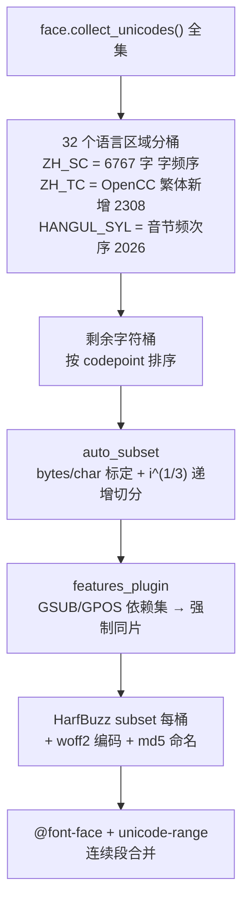

# cn-font-split 字体拆分逻辑研究

研究对象：[KonghaYao/cn-font-split](https://github.com/KonghaYao/cn-font-split) 7.x（Rust + HarfBuzz，Apache-2.0）。
目的：为自建"预分片中文字体 CDN 构建工具"（见 [`font-artifact-contract.md`](./font-artifact-contract.md) 的产物契约）确定可借鉴的算法与必须避开的坑。

> 背景研究：本文记录选型阶段的对比与实测，不是当前实现的规范。当前行为以 `font-artifact-contract.md`、`python-implementation.md` 和 `AGENTS.md` 为准。

研究方法：clone 源码逐文件阅读 + 用 Python `fontTools 4.64` 在本机完整复现它的调度算法并实测每个分片的真实体积。**本文所有数字均为实测值，非估算**；复现方法见 §8。

---

## 1. 一句话结论

不是"每 N 个 codepoint 一刀切"，而是三层组合：

1. **语言区域分桶**（中文用**字频表**，不是 Unicode block）；
2. 桶内按"目标字节数"做 **`i^(1/3)` 递增切分**（首片小、尾片大）；
3. 用 **GSUB/GPOS 依赖约束**把必须同片的字符**整体塞进同一个桶**。

最后每桶交给 HarfBuzz subsetter 做真正的 OpenType-aware 子集化，`unicode-range` 由该桶**实际字符集**合并连续段生成。



## 2. 流水线（源码位置）

| 阶段 | 文件 | 行为 |
|---|---|---|
| 0 取全集 | `src/pre_subset/mod.rs:42` | `face.collect_unicodes()`（HarfBuzz cmap）→ `BTreeSet`；另用 `opentype` crate **独立重读** name/fvar/cmap/GSUB/GPOS（两条解析链各读一遍字体） |
| 1 语言区域分桶 | `src/pre_subset/plugin.rs:language_area_plugin` + `crates/lang_unicodes/src/{lib.rs,cjk_unicodes.rs}` | 32 个区域**按固定顺序**与 `remaining` 求交集（交集保持区域内部的字符顺序），非空即成一桶；有副作用地 `remaining.remove()`，保证一个字符只归一个桶 |
| 2 剩余桶 | `src/pre_subset/plugin.rs:add_remain_chars_plugin` | 剩余全部字符（CJK Ext A/B、增补平面、组合记号…）**按 codepoint 排序**成一个桶，**无语言标签** |
| 3 自动切分 | `src/pre_subset/plugin_auto_subset.rs` | 标定 bytes/char → 桶内 `i^(1/3)` 递增切分（§3） |
| 4 特性依赖 | `src/pre_subset/features.rs` + `features/{cmap,gsub,gpos}.rs` | 每个 GSUB/GPOS lookup 收集涉及的 glyph 集合 → cmap 反查成字符集 → 强制同片（§4） |
| 5 产出 | `src/run_subset.rs` | 每桶 `Subset{clear_drop_table + adjust_layout + add_chars}` → `woff::version2::compress` → `md5(片字节).woff2`；rayon 并行 |
| 6 CSS | `src/link_subset/output_css.rs` + `crates/unicode_range` | 一桶一条 `@font-face`，`unicode-range` = 该桶字符排序去重后合并连续段 |
| 7 汇总 | `src/link_subset/mod.rs`, `src/run_subset.rs` | 输出 `result.css` / `<md5>.woff2` / `index.html` / `index.proto` / reporter(protobuf)；**没有 manifest.json** |

入口：`src/runner.rs:font_split`，配置由 protobuf `InputTemplate` 描述（`crates/proto/src/index.proto`）。

## 3. 分片算法（`plugin_auto_subset.rs`）

```rust
// 标定：估算每个字符平均占多少字节
let space = (size / 100).min(1);              // ← 见 §7 bug#4：实际永远是 1
let sample = extract_every_nth(&all_unicodes, space);
let bytes_per_char = build_single_subset(face, &sample).len() / sample.len();
let chars_per_subset = chunk_size / bytes_per_char;   // chunk_size 默认 70KB

// 切分：第 i 片容纳 ceil(min_count * i^(1/3)) 个字符，封顶 chars_per_subset
let min_count = chars_per_subset / 5;
let len_i = min(ceil(min_count * i^(1.0/3.0)), chars_per_subset);
```

- **递增而非等分**：第 1 片只有目标容量的 1/5，之后按立方根爬升到封顶。意图是让"最常被命中的片"最小。
- **系数调整**（`plugin_auto_subset` 内 `match lang`）：`ZH_TC` ×0.5（注释："繁体中文一般比简体中文要大一倍复杂度"），无语言标签的剩余桶 ×0.7，其余 ×1.0。
- **桶内顺序 = 入桶顺序**：`IndexSet` 保序，所以 `ZH_SC` 桶切片后，**分片 0 就是最常用的那批字**。这是整套方案真正的工作机制。
- `OptLevel` 枚举按字体字符数分档（`<1000` 时退化为每片都取 `chars_per_subset`），但 `LOW/MID/HIGH` 三档公式相同，实际只区分了"小字体不递增"。

### 语言区域词表（32 项，`crates/lang_unicodes`）

- 绝大多数区域就是 Unicode block：`LATIN` = U+0001-007F（**排除 U+0000**，0 被当作占位符）、`LATIN_1`、`LATIN_EXT_A/B`、`IPA`、`GREEK`、`CYRILLIC`、假名（U+3040-30FF）、`HALFWIDTH_FULLWIDTH`(U+FF00-FFEF) 等。
- **中文/韩文不是 block**：
  - `ZH_SYMBOL` = 75 个中文标点（`。，、：；！？「」《》【】——……` …，来源 W3C clreq + 维基）；
  - `ZH_SC` = **6767 个常用简体汉字，字频降序**，硬编码在 `crates/lang_unicodes/build.rs` 的 `CN_CHARS`（头部 `的一是在有人中和不为学国…`），构建期写成 `data/cn_char_rank.dat`（gitignore 的生成物）；
  - `ZH_TC` = 该表经 **OpenCC S2T** 转换后**新增的** 2308 字（繁体独有），单独成区并享受 ×0.5 系数；
  - `HANGUL_SYL` = 2026 个音节，**按语料频次序**（来源 `scripts/syl-2.txt`）。
- 区域表是这份工具的**核心资产**：它把"中文常用字"这个语义注入了分包结构。脱离它就只能退化成 block 分片。

## 4. GSUB/GPOS 依赖闭包（`features.rs`）

对 `GSUB`、`GPOS` 的每个 lookup：

1. 收集该 lookup 所有涉及到的 glyph id（`features/{gsub,gpos}.rs` 展开各类 subtable/coverage/context 格式）；
2. 用 cmap 反查成字符集（`turn_indics_to_unicode_set`，`HashMap<u16 gid, u32 unicode>`，**无 cmap 的 glyph 折叠成 `U+0000` 占位**）；
3. `move_feature_set_to_front`：把该字符集**整体插入第一个有交集的桶**，并把这些字符**从后续所有桶中删除**。

效果与代价：

- 好处：满足"一个字符只归一个桶"，同时让 `liga`/`ccmp`/`vert` 这类**跨字符**规则在片内自洽，避免被 HarfBuzz 逐片闭包时拆散或重复携带依赖 glyph。
- 代价：会生成**空桶**（后置 `filter(|v| !v.is_empty())` 掉），意味着实际分片数无法精确预测；`U+0000` 会被塞进相关分片，出现在 `unicode-range` 里。
- 边界情况：若某 lookup 的字符集**只有无 cmap 的 glyph**（全部折叠成 `U+0000`），则与任何桶都无交集，约束**不会生效**——这类依赖只能靠 HarfBuzz 逐片闭包兜底（即重复携带）。

## 5. 子集化与编码（`run_subset.rs`）

```rust
let subset_runner = Subset::new();
subset_runner.clear_drop_table();   // 清空 drop-table 集合 → 尽量不丢表
subset_runner.adjust_layout();      // layout feature/script 集合 invert → 保留全部 feature/script
subset_runner.add_chars(&subset);   // unicode 集合
let face = subset_runner.run_subset(face);            // HarfBuzz hb_subset_or_fail
let woff2 = woff::version2::compress(ttf_binary, "", 1, true);
```

- `adjust_layout()` 等价于 fontTools 的 `layout_features='*'`（保留全部 OpenType feature）。
- Composite glyph、GSUB/GPOS 依赖、kerning 全部交给 HarfBuzz 处理，**不手工删 glyph**——这一点与需求"不要低层暴力删除 glyph"一致。
- 输入支持 TTF/OTF/WOFF2（`src/loader.rs:smart_load_woff2` 先解压 WOFF2 再处理）。
- 输出编码是 Google `woff2` C++（`bodoni/woff` crate 的 FFI），参数 `quality=1, transform=true`。**quality=1 是 brotli 最低档**（同 crate `convert()` 默认 8，`woff2_compress` 默认 11）→ 用最低压缩质量换构建速度。这是可以、也应该优化掉的一点。

## 6. CSS 与产物

- 一桶一条 `@font-face`：`font-family` / `src`（`local()` 在前、`url("./<file>")format("woff2")` 在后）/ `font-style` / `font-display`(默认 `swap`) / `font-weight` / `unicode-range`。
- `unicode-range` = `UnicodeRange::stringify(桶字符)`：排序去重后**合并连续段**，输出 `U+4E00,U+4E0A,U+4E0D-4E0E,…`。范围精确等于该片真实字符集 → 天然不重叠、无空档。
- `@font-face` 输出顺序是 `run_subset_result.iter().rev()`（**倒序**）。
- 文件名默认 `md5(片字节).woff2`（内容寻址），可用 `rename_output_font` 模板改为 `font_[index].[ext]` 之类。
- 汇报由 protobuf `OutputReport` 承载：`subset_detail[]{id,file_name,hash,chars[],bytes,duration}`、`bundle_message{origin_size,bundled_size,origin_bytes,bundled_bytes}`、`css{family,style,display,weight}`。**没有 JSON manifest**，也没有版本化路径/目录语义。

## 7. 已知缺陷与坑（借鉴时必须避开）

| # | 位置 | 问题 | 影响 |
|---|---|---|---|
| 1 | `plugin_auto_subset.rs` | 单一全局 `bytes_per_char`：用**整份字体**的平均密度去套所有区域 | 各区域密度差异巨大（实测 Latin 含闭包 357 B/字 vs CJK 270 B/字；Latin 去掉闭包只有 85 B/字）→ Latin 片过小、CJK 片过大。实测最大片 90.8 KB 已超 70 KB 目标 |
| 2 | `features.rs` | 依赖集里无 cmap 的 glyph 折叠成 `U+0000` | 污染 `unicode-range`；纯 unicode-less 依赖集检测不到交集 → 约束失效 |
| 3 | `features.rs` | 强制同片会把字符从后续桶删除，产生空桶 | 分片数不可预测，实际布局依赖字体内部 lookup 结构 |
| 4 | `plugin_auto_subset.rs` | `let space = (size / 100).min(1)`，应为 `.max(1)` | 采样永远是全量 → 构建时白跑一次"整份字体 subset + woff2 压缩"（实测本机 78 s） |
| 5 | `plugin.rs` + `plugin_auto_subset.rs` | `used_languages` 用**区域下标**为键，但读取时按**紧凑后的桶下标** `enumerate()` 取值 | 有区域为空时标签错位，`ZH_TC` 的 ×0.5 系数会套到别的桶上 |
| 6 | `output_css.rs` | `@font-face` 输出 `.rev()` 倒序 | 与分片优先级顺序不一致，阅读/预载策略容易踩坑 |
| 7 | `run_subset.rs` | `woff::version2::compress(..., quality=1, ...)` | 每个文件都偏大（同 crate 默认 8、官方 `woff2_compress` 默认 11） |
| 8 | 全流程 | 无 `manifest.json`、无版本化路径、默认 md5 命名 | 不利于 CDN 发布、长期缓存管理、产物审计 |

## 8. 实测：用 fontTools 复现该调度并测体积

**方法**：取 Windows 自带 `NotoSansSC-VF.ttf`（可变字体，17,773,244 B，31036 glyphs，cmap 30890 字符）→ 用 §2 的桶逻辑（`crates/lang_unicodes` 的区域表 + build.rs 里的 `CN_CHARS` 字频表，`ZH_TC` 因需 OpenCC 生成、本机无表，并入剩余桶）生成计划 → 每个桶用 `fontTools.subset`（`layout_features='*'`, `notdef_outline=True`）子集化并保存为 WOFF2，记录真实字节。

**标定结果**：`bytes_per_char = 251.2`（整字体 WOFF2 7,760,560 B ÷ 30890 字符）→ 70 KB 目标下 `chars_per_subset = 285`。

**总计**：

| 指标 | 实测值 |
|---|---|
| 分片数 | **213** |
| 总字节 | **10,458,752 B（9.97 MiB）** |
| 对照：单文件 WOFF2 | 7,760,560 B（7.40 MiB） |
| 体积膨胀 | **+34.8%**（碎片固定开销 + 跨片闭包重复 + 小 brotli 块压缩率下降） |
| 单片体积 | min 1.9 KB / 中位 52.6 KB / max **90.8 KB**（53 个 > 64 KB） |
| 字符覆盖 | 30890 = cmap 全覆盖，零遗漏 |
| CSS | 116,875 B 原始 / **22,454 B brotli** |
| `unicode-range` 段数 | **10,803**（平均 50.7 段/片，`han` 片 **148.2 段/片**） |

**按区域分布**：

| 标签 | 分片 | 字符 | KB | UR 段数 |
|---|---|---|---|---|
| `han-ext`（剩余桶） | 150 | 23294 | 7706 | 4079 |
| `han`（ZH_SC 字频序） | 45 | 6767 | 2281 | 6668 |
| `kana` | 3 | 189 | 91 | 4 |
| `full` | 4 | 223 | 56 | 12 |
| `latin` | 2 | 95 | 38 | 2 |
| `latin1` | 2 | 96 | 12 | 2 |
| `cyrillic` | 2 | 66 | 9 | 4 |
| `latinext` | 2 | 53 | 8 | 14 |
| `greek` / `sym` / `ipa` | 1/1/1 | 49/48/10 | 7/4/2 | 3/8/7 |

**分片样例（真实体积）**：

| 文件（示意命名） | 字符 | 体积 | UR 段 | `unicode-range` 开头 |
|---|---|---|---|---|
| `…-000-latin…` | 57 | 21.5 KB | 1 | `U+20-58` |
| `…-010-sym…` | 48 | 4.4 KB | 8 | `U+2E3A,U+3001-3002,U+3008-3011,…` |
| `…-011-han…` | 57 | 13.8 KB | 55 | `U+4E00,U+4E0A,U+4E0D-4E0E,U+4E1A,…`（`的一是在有…`） |
| `…-055-han…` | 20 | 9.6 KB | 20 | 字频表尾部 |
| `…-056-kana…` | 57 | 25.8 KB | 1 | `U+3041-3079` |
| `…-100-han-ext…` | 132 | 43.9 KB | 1 | `U+3AFB-3B7E` |
| `…-212-han-ext…` | 101 | 41.2 KB | 88 | `U+2C0A9,U+2C0CA,…`（增补平面） |

**字频分片的收益（用上表真实字节累加）**：

| 页面用到的字符 | 需要拉取的分片 | 字节 |
|---|---|---|
| ASCII + 中文标点（`latin`×2 + `latin1`×2 + `latinext`×2 + `sym`） | 7 片 | 61.6 KB |
| 最常用 500 字 | base + `han 000-005` | 202 KB |
| 最常用 1000 字 | base + `han 000-010` | 382 KB |
| 最常用 2000 字 | base + `han 000-017` | 701 KB |
| 最常用 3500 字（≈99% 日常文本） | base + `han 000-026` | 1.20 MB |
| 全量（含 Ext B / 增补平面） | 213 片 | 9.97 MB |

对照：若改按 **codepoint 排序**分片，同样 30890 字符只需 139 片 / 586 个 UR 段（CSS 可降到 ~3 KB brotli），但"最常用 1000 字"会散落在 45 个 CJK 分片里 ≈ 1.78 MB 全量。**这就是字频分片存在的理由，也是它必须付 10k 段 CSS 的代价。**

**横向对照**：现网 Google Fonts 的 `Noto Sans SC` CSS = 101 片 / **9068 段** / 111,918 B。与本文模拟的 213 片 / 10803 段 / 116,875 B 同一量级 → **碎片化 `unicode-range` 是这类预分片方案的常态**，不是 cn-font-split 的缺陷。区别只在片数（chunk size）与命名。

## 9. fontTools 等价实现要点（已在本机验证）

> 选型结论：**采用 Python（`uharfbuzz` 做子集化内核 + `fontTools` 做内省与 WOFF2 编码）**，详见 [`python-implementation.md`](./python-implementation.md)。

对"用 Python `fontTools` 重写这条流水线"的可行性验证结论：

| 结论 | 证据 |
|---|---|
| fontTools 的 layout closure 会**自动拉入依赖 glyph**（unmapped 形式），与 HarfBuzz 行为同向 | `fi` 子集 → 额外 `uniFB00/uniFB01/uniFB03/uniFF46/uniFF49` |
| fontTools **cmap 严格裁剪**为请求字符 | 上述子集 `getBestCmap()` 只含请求的 2 个字符 → **`unicode-range` 可以精确生成**，满足"不重叠、一字符一片" |
| composite / glyph 依赖自动处理 | 只需 `Subsetter.populate(unicodes=...)` + `subset()` |
| 但要**自己补** cn-font-split 的"强制同片"步骤 | fontTools 逐桶独立闭包，同一规则的两侧各带一份依赖 glyph（浪费）或规则失效 |
| WOFF2 输出依赖 `brotli` 包 | 本机 `fontTools 4.64.0` + `brotli 1.2.0` 通过 |
| **不要照抄"保留全部 feature"** | LATIN `U+1-7F`（127 字）：`layout_features='*'` → 431 glyphs / 41.4 KB；`[]` → 96 glyphs / 10.5 KB（**+295%**）。多出的 336 个 glyph 全是全角/假名/带圈 CJK/连字，**不在这片的 unicode-range 内** |
| 逐 feature 归因（LATIN 片） | `aalt` 27.7 KB（191 deps）、`dlig` 23.9 KB（107）、`fwid` 18.9 KB（96）、`hwid` 18.4 KB（96）、`locl` 11.4 KB（13）、`liga` 11.0 KB（6）、基线（无 feature）10.5 KB。`liga+locl` 组合仅 11.9 KB / 18 deps |
| CJK 片几乎不受 feature 影响 | 285 常用汉字：`'*'` 71.7 KB vs `[]` 69.5 KB |
| 小分片无惩罚 | 10 字 3.1 KB、35 字 8.6 KB、100 字 24.7 KB、300 字 75.4 KB、1000 字 253 KB、6767 字 1784 KB → 边际 ≈ 250-270 B/字，固定开销 ~1 KB 级 |

**结论**：纯 fontTools 重实现可行且可控；必须替换/新增的三件事是——(1) 按区域分别标定 bytes/char；(2) 自己实现跨片依赖归并；(3) feature 白名单可配置（`aalt`/`dlig` 默认关）。另外 `woff::version2::compress(..., quality=1, ...)` 的低压缩质量应在原版之上改进。

## 10. 现成替代实现

PyPI 上有官方 `cn-font-split 7.1.0`（`packages/ffi-py`，ctypes 包装，运行时按平台从 GitHub 下载 `.dll/.so/.dylib`，README 自称 Beta）。

- 优点：成熟、快、跨平台产物一致。
- 缺点：黑盒二进制 + 运行时下载、无 manifest、md5 命名、策略参数受其 protobuf 限制、以及 §7 的全部坑。
- 判断：适合"立刻要结果"，不适合"要可控产物契约 + 版本化 CDN 发布"。本项目选择纯 fontTools 自研，但算法上按本文 §1-§4 对齐。

## 11. 参考资料

- 仓库：<https://github.com/KonghaYao/cn-font-split>（Apache-2.0）
- 源码路径（对应本文）：`src/runner.rs`, `src/pre_subset/{mod.rs,plugin.rs,plugin_auto_subset.rs,features.rs,features/{cmap,gsub,gpos}.rs}`, `src/run_subset.rs`, `src/loader.rs`, `src/link_subset/{mod.rs,output_css.rs,name_template.rs}`, `crates/lang_unicodes/*`, `crates/unicode_range/src/lib.rs`, `crates/proto/src/index.proto`
- HarfBuzz subset 封装（其 fork）：<https://github.com/KonghaYao/harfbuzz_rs> `src/subset.rs`
- WOFF2 编码器：<https://github.com/bodoni/woff>（Google woff2 C++ FFI）
- 中文标点范围参考：W3C clreq 标点表
